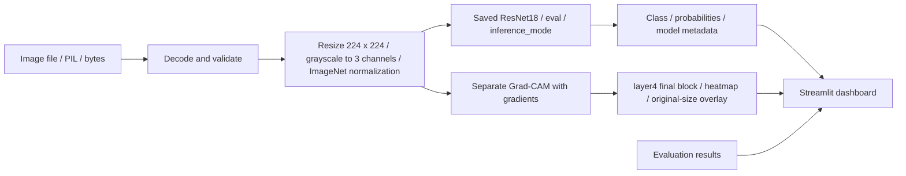
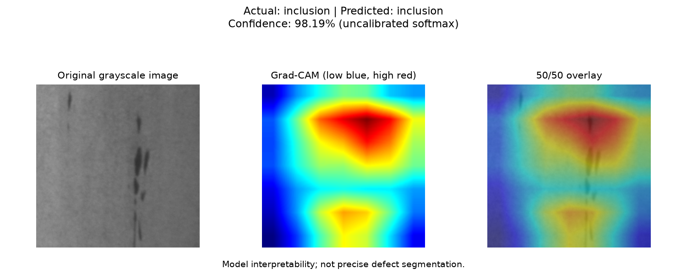

# VisionForge

**Steel surface defect classification with PyTorch, ResNet18 and Grad-CAM.**

VisionForge turns an uploaded steel surface image into a six-class prediction, class probabilities and a visual explanation. It compares a CNN built from scratch with transfer learning on NEU-CLS and presents results in a dark Streamlit dashboard. The selected ResNet18 classified **269 of 270 held-out test images correctly: 99.63% accuracy and 0.996296 macro-F1**.

Industrial surface inspection can be repetitive and sensitive to lighting and texture. This project explores computer vision as an inspection aid through reproducible splits, leakage checks, measured evaluation and transparent limitations. It is a portfolio prototype, not a validated factory quality-control system.

## Dashboard

- **Inspection:** upload PNG, JPG, JPEG or BMP; preview the image; inspect the predicted class, uncalibrated confidence and all six probabilities; generate Grad-CAM separately; download prediction JSON.
- **Model Performance:** compare actual test metrics, confusion matrices and per-class results for both saved models.
- One cached ResNet18 resource supports CUDA when available and CPU hosting. Local operation needs no paid API, account or external inference service.

The classifier recognizes **crazing, inclusion, patches, pitted surface, rolled-in scale and scratches**. It has no defect-free class, unknown-class detection or segmentation output.

## Architecture



Training adds horizontal/vertical flips and small rotations; evaluation and inference use deterministic transforms without augmentation. Grad-CAM runs in FP32 with gradients enabled outside inference mode. CUDA classification can use FP16, so explanation and classification scores may differ slightly.

```text
app.py                       Streamlit dashboard
src/dataset.py               Shared transforms and DataLoaders
src/models.py                Custom CNN, ResNet18 and checkpoint loading
src/train.py                 Reproducible training and reports
src/evaluate.py              Leakage audit and held-out evaluation
src/explain.py               Grad-CAM and visualizations
src/inference.py             Validated reusable inference pipeline
src/split_data.py             Deterministic dataset preparation
tests/                       Data, model, inference, app and deployment tests
deployment/                  Runtime dependencies, evaluation, manifest, startup
docs/                        Dataset and deployment guides
data/{raw,processed}/        Local datasets; excluded from Git
artifacts/{models,reports}/  Local weights/reports; excluded from Git
```

**Technology:** Python 3.11, PyTorch, TorchVision, NumPy, pandas, scikit-learn, Pillow, OpenCV, matplotlib, pytorch-grad-cam, Streamlit, Altair and pytest. Local development uses an NVIDIA RTX 3050 Laptop GPU; deployment uses CPU PyTorch wheels.

## Dataset and attribution

The **NEU surface defect classification dataset (NEU-CLS)** is provided by Northeastern University. Its official [dataset page](https://faculty.neu.edu.cn/songkc/en/zdylm/263265/list/) provides attribution and downloads. This project uses NEU-CLS, not NEU-DET detection annotations.

There are 1,800 grayscale images, 200 × 200 pixels, with 300 images per class. Stratified splitting with seed 42 produced:

| Split | Images | Per class |
|---|---:|---:|
| Training | 1,260 | 210 |
| Validation | 270 | 45 |
| Test | 270 | 45 |

Before test evaluation, the audit found **no exact or suspicious cross-split duplicates** under its hash and perceptual-similarity checks. One exact duplicate pair (`Pa_101.bmp`, `Pa_105.bmp`) exists entirely within training, giving 1,799 unique image contents. The heuristic audit cannot rule out every correlated acquisition or transformed duplicate.

Datasets are not distributed with the repository or deployment image. See the [dataset and training guide](docs/DATASET.md) for download, splitting and reproduction instructions. Respect the source provider's terms when using or redistributing data and weights.

## Measured model comparison

Metrics come from saved training and final evaluation reports. Test images were used for final evaluation, not training or model selection.

| Metric | Custom CNN | ResNet18 |
|---|---:|---:|
| Validation accuracy | 97.04% | 100.00% |
| Validation macro-F1 | 0.970389 | 1.000000 |
| Test accuracy | 94.44% | **99.63%** |
| Test macro precision | 0.944920 | **0.996377** |
| Test macro recall | 0.944444 | **0.996296** |
| Test macro-F1 | 0.944605 | **0.996296** |
| Mistakes / 270 test images | 15 | **1** |
| Parameters | 390,438 | 11,179,590 |
| Training duration | 75.22 s | 106.43 s |
| Epochs completed | 12 | 18 |
| Selected epoch | 7 | 13, fine-tuning phase epoch 8 |
| GPU forward latency, mean | 0.894 ms | 3.922 ms |

Latency: RTX 3050, batch size 1, CUDA FP16, 30 warm-ups and 200 timed forwards. It excludes decoding, preprocessing, data transfer, UI work and Grad-CAM; it is not an end-to-end hosting benchmark.

The CNN uses four convolution/BatchNorm/ReLU/pooling blocks, global average pooling and dropout. ResNet18 starts with official TorchVision ImageNet weights, trains a six-class head with a frozen backbone, then fine-tunes `layer4` at learning rate 1e-5. Both use AdamW, cross-entropy, seed 42 and validation macro-F1 checkpoint selection.

ResNet18 test accuracy is 0.37 percentage points below validation; CNN accuracy is 2.59 points below. ResNet18's sole mistake was inclusion image `In_240.bmp` predicted as pitted surface. The dashboard reads the actual [evaluation snapshot](deployment/evaluation.json), including confusion matrices and per-class metrics. Original reports remain locally under `artifacts/reports/`.

## Visual explanation



The example shows an inclusion image from the validation split alongside its Grad-CAM heatmap and overlay. Grad-CAM highlights regions influencing a class prediction; it is model interpretability, **not precise defect segmentation** or proof of correctness.

## Installation and local usage

Requirements: Python 3.11 and a compatible ResNet18 checkpoint. CUDA is optional. Clone the repository and create an isolated environment. The following Windows/PowerShell commands install CPU PyTorch; use the [official selector](https://pytorch.org/get-started/locally/) for CUDA wheels:

```powershell
git clone https://github.com/Kartikesh07/VisionForge.git
cd VisionForge
py -3.11 -m venv .venv
# CPU installation; use the official selector for CUDA:
& .\.venv\Scripts\python.exe -m pip install torch==2.14.1 torchvision==0.29.1 --index-url https://download.pytorch.org/whl/cpu
& .\.venv\Scripts\python.exe -m pip install -r deployment/requirements.txt
# Development/testing only:
& .\.venv\Scripts\python.exe -m pip install pytest==9.1.1
```

Linux/macOS: use `.venv/bin/python` and `source .venv/bin/activate`. All Python commands must use that environment. Root `requirements.txt` records the development stack; deployment requirements omit tests and install PyTorch separately to select CPU wheels.

### Model checkpoint

Trained weights are excluded from Git, and a public checkpoint download is not currently provided. To run the dashboard, obtain the release checkpoint from the maintainer and place it at `artifacts/models/resnet18_best.pth`, or reproduce training using the [dataset guide](docs/DATASET.md). The published metrics describe the original release checkpoint; a newly trained model may produce different results and must be evaluated separately.

The release checkpoint has size **44,798,219 bytes** and SHA256:

```text
ca32161ed4977e5390bc939d9fb3058da3cdec7b11a3c38cfc8c4ebf7ce0b380
```

### Launch the dashboard

After providing the checkpoint:

```powershell
& .\.venv\Scripts\python.exe -m pip check
& .\.venv\Scripts\python.exe -m streamlit run app.py
```

Open the printed local URL. Upload an image, choose **Analyze surface**, then optionally generate Grad-CAM. Validation samples are available when the local dataset is present; image uploads do not require downloading the dataset.

To force CPU execution:

```powershell
$env:VISIONFORGE_DEVICE = 'cpu'
& .\.venv\Scripts\python.exe -m streamlit run app.py
```

### Python API

```python
from src.inference import InferencePipeline

pipeline = InferencePipeline(device="auto")
result = pipeline.predict("surface.bmp")  # also PIL images or bytes
print(result.to_dict())
explanation = pipeline.explain("surface.bmp")  # outside inference_mode()
```

Decoding rejects corrupted images and enforces a 20 MiB / 20 megapixel limit. Softmax confidence is **uncalibrated**. Shared model operations are serialized; this prototype is not load-tested for industrial concurrency.

## Tests

```powershell
& .\.venv\Scripts\python.exe -m pytest -q
& .\.venv\Scripts\python.exe scripts/final_smoke.py
```

The CPU smoke script hides CUDA before importing PyTorch and exercises PNG/JPG/JPEG/BMP upload bytes through Streamlit AppTest, predictions, probability charts, Grad-CAM and the performance section. CUDA tests run when available. The full suite requires the prepared NEU-CLS dataset and both trained checkpoints; see [dataset setup](docs/DATASET.md).

Release validation: **147 tests passed**. CPU AppTest checks cover all four upload extensions, predictions, probability charts, Grad-CAM and performance navigation. Smoke inputs use validation images. Browser visual regression and Linux container execution are not covered by these checks.

## Deployment

A CPU Dockerfile, port 7860 configuration, non-root runtime, health check and checksum-verified checkpoint delivery are included. See the [deployment guide](docs/DEPLOYMENT.md) for local Docker and Hugging Face Spaces configuration. A public hosted demo is not currently available. The container configuration has not yet been validated with a Linux build.

Hugging Face's built-in Streamlit SDK is deprecated; its documentation directs Streamlit projects to Docker Spaces. Its current overview says new Docker Spaces require a paid account plan, although CPU Basic has no hourly compute charge. Local CPU operation needs no paid service. Check current eligibility before choosing hosting. Sources: [Streamlit Spaces](https://huggingface.co/docs/hub/spaces-sdks-streamlit), [Spaces overview](https://huggingface.co/docs/hub/spaces-overview).

## Limitations and future improvements

- The balanced 270-image test set supports this benchmark, not generalization to new mills, cameras, lighting or production distributions.
- All labels are defect types; healthy, unknown and out-of-distribution surfaces can receive confident incorrect predictions.
- Confidence is uncalibrated. Grad-CAM provides coarse class evidence rather than defect boundaries.
- Duplicate checks do not eliminate every acquisition-level dependence; external validation would strengthen results.
- Future work could add healthy/unknown classes, calibration, external validation, monitoring and throughput benchmarks. These are not implemented.

Datasets, environments, model weights, caches, secrets and generated artifacts are excluded from Git. The evaluation JSON and Grad-CAM example are included to document the benchmark results.
